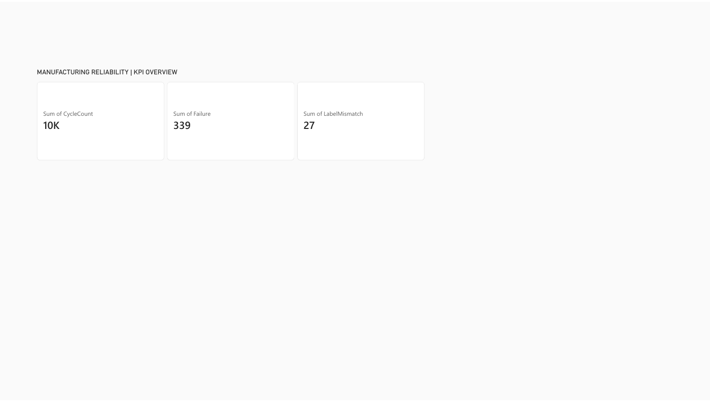
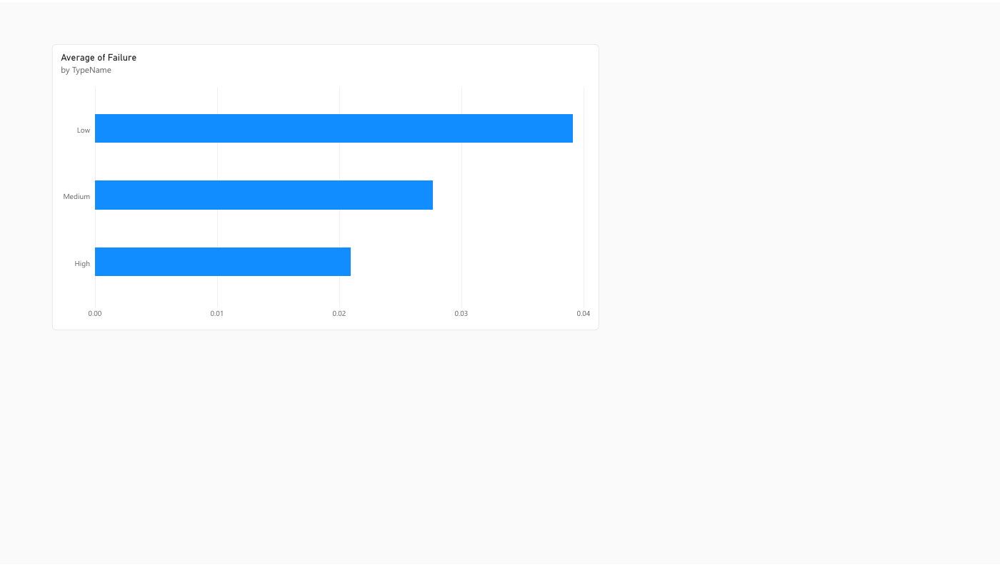
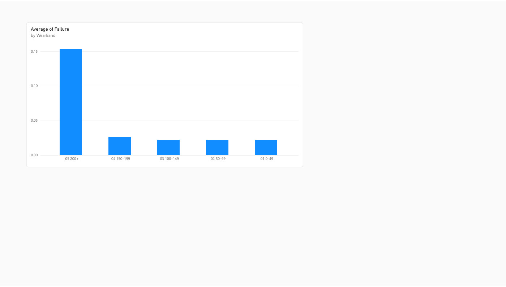
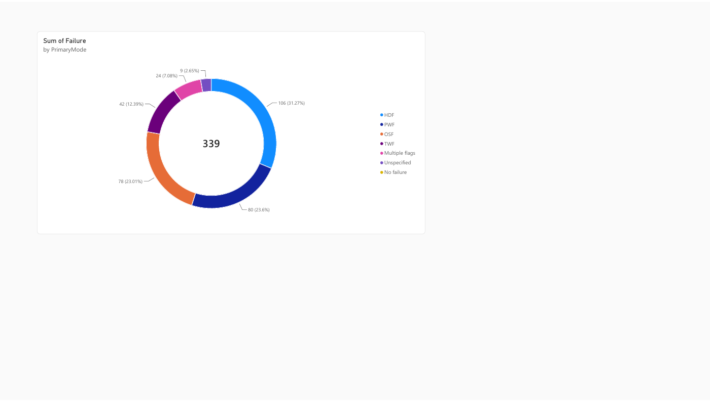

# Manufacturing Reliability | Power BI KPI Review

An interactive maintenance analytics case study built from the [UCI AI4I 2020 Predictive Maintenance dataset](https://archive.ics.uci.edu/dataset/601/ai4i%2B2020%2Bpredictive%2Bmaintenance%2Bdataset). It demonstrates KPI design, product-variant comparisons, process-signal exploration, and a source-label audit. **The data is synthetic**; these observations are descriptive, not evidence of real equipment performance.

## Dashboard

The [four-page Power BI report](https://app.powerbi.com/groups/e6426da3-9b36-4519-acf1-2434daa552ae/reports/38902a90-0838-4686-b17e-2e6b31830a1f) covers:

1. **KPI Overview:** 10,000 cycles, 339 labeled failures, and 27 label/mode disagreements.
2. **Product Variants:** labeled failure rate by L/M/H product quality variant.
3. **Tool Wear:** labeled failure rate by wear band.
4. **Failure Modes:** color-coded breakdown of mutually exclusive display categories among failed records.

The report is hosted in Power BI My workspace, so opening it may require the owner's access. The [PDF export](visuals/manufacturing-reliability-report.pdf) and the previews below make the findings public.






## Verified findings

| Measure | Result |
|---|---:|
| Machine-cycle records | 10,000 |
| Labeled failures | 339 |
| Failure rate | 3.39% |
| Label/mode disagreements | 27 |
| Failed rows without any mode flag | 9 |
| Nonfailed rows with a mode flag | 18 |
| Failed rows with multiple mode flags | 24 |

Low product variants have a 3.92% labeled failure rate (235/6,000), medium 2.77% (83/2,997), and high 2.09% (21/1,003). These are product-quality variants in the source, not separate machines. Records with tool wear of at least 200 minutes have a 15.36% failure rate (123/801); lower wear bands range from about 2.2% to 2.7%.

The calculated mechanical-power bands show 31/31 failures below 3.5 kW and 64/64 above 9 kW. **These limits are part of the synthetic data-generation rules** and should not be treated as newly discovered causal thresholds or a deployable alert policy. See [Findings and caveats](reports/FINDINGS.md).

## Reproduce

```bash
python -m pip install -r requirements.txt
python scripts/analyze.py
```

The script downloads the official UCI ZIP on first run, validates source shape, keys and labels, then writes the [Power BI import table](data/events.csv) and metric summaries in [reports](reports/). Source ZIP SHA-256: `f601f14294bcf190f9d720676b7f0aea46a26cde9ab8ebc7b4f8174d9d26b252`.

Power BI source URL: `https://raw.githubusercontent.com/patelkautilya/manufacturing-reliability-powerbi/main/data/events.csv`. See the [field guide](reports/FIELD_GUIDE.md) for definitions and limitations.

## Source and license

AI4I 2020 Predictive Maintenance Dataset, UCI Machine Learning Repository, DOI [10.24432/C5HS5C](https://doi.org/10.24432/C5HS5C), licensed [CC BY 4.0](https://creativecommons.org/licenses/by/4.0/). This repository attributes the source and publishes derived analysis for portfolio demonstration.
